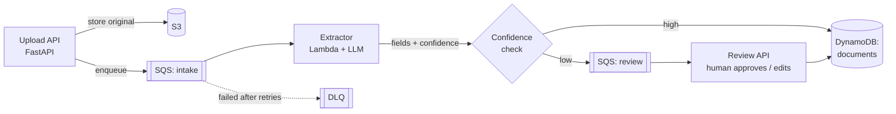

# DocumentIntake
LLM-powered invoice extraction pipeline on AWS (FastAPI, SQS, Lambda, DynamoDB) with idempotent retries and human review for low-confidence results. Work in progress.


# Document Intake Agent

An LLM-powered pipeline that turns messy invoices (PDFs and emails) into clean, structured data, and sends anything it isn't sure about to a human for review.

> **Status: in progress (started October 2026).** This README describes the design and the build plan. Sections are marked ✅ when done and ⏳ when planned.

## Why

Finance and operations teams still re-type invoice data by hand. Documents come in different layouts, as scanned PDFs or email bodies, and a single wrong field (amount, due date, vendor) causes real downstream problems. This project explores how to automate that work reliably:

- **Extract** structured fields with an LLM instead of brittle templates.
- **Know when it's unsure.** Every field gets a confidence score, and low-confidence documents go to a human review queue instead of flowing through silently.
- **Never process a document twice.** The pipeline is event-driven with retries, so every step is idempotent.

## Architecture



**Flow**

1. A client uploads an invoice (PDF or raw email) to the **FastAPI** upload endpoint.
2. The original file is stored in **S3**, and a message with the document ID is put on the **intake SQS queue**.
3. An **extractor Lambda** reads the document, calls an **LLM API** with a strict output schema, and validates the result (types, totals add up, dates parse).
4. Each field gets a confidence score. If every required field passes its threshold, the record is written to **DynamoDB**. Otherwise it goes to the **review queue**.
5. A reviewer approves or corrects the fields through the **review API**, and the final record is saved.
6. Messages that keep failing land in a **dead-letter queue** for inspection.

## Reliability design

| Concern | Approach |
|---|---|
| Duplicate messages (SQS is at-least-once) | Idempotency key per document; conditional writes in DynamoDB so a repeated message is a safe no-op |
| Transient LLM or network failures | Retries with exponential backoff; dead-letter queue after N attempts |
| Partial failures mid-pipeline | Each step records its state; a retried step resumes from the last committed state |
| Bad LLM output | JSON schema validation and business-rule checks before anything is saved |
| Silent errors | Low-confidence results always go to human review, never straight through |

## Extracted fields (v1)

`vendor_name`, `invoice_number`, `invoice_date`, `due_date`, `currency`, `subtotal`, `tax`, `total`, `line_items[]` (description, quantity, unit price, amount).

## Tech stack

- **API:** Python, FastAPI
- **Cloud:** AWS Lambda, SQS (with DLQ), DynamoDB, S3
- **AI:** Anthropic Claude API with structured (JSON schema) output
- **Infra:** Infrastructure as code (planned)
- **Testing:** pytest, with a labelled evaluation set of public sample invoices

## Build plan

- ✅ Repo setup, README, architecture, invoice schema and business-rule validation
- ✅ Local development environment (emulated S3, SQS with DLQ, DynamoDB)
- ⏳ Upload API and S3 storage
- ⏳ SQS intake queue and extractor Lambda
- ⏳ LLM extraction with schema validation
- ⏳ Confidence scoring and the human review queue
- ⏳ Idempotency keys, retries and dead-letter queue
- ⏳ Evaluation set and accuracy report (per-field precision)
- ⏳ Deployed demo and short walkthrough video

## Prerequisites

| Requirement | Needed for | Notes |
|---|---|---|
| macOS or Linux with `make` | All local commands | `make` ships with macOS (Xcode Command Line Tools) |
| [uv](https://docs.astral.sh/uv/) | Python and dependencies | Install: `curl -LsSf https://astral.sh/uv/install.sh \| sh`. It downloads **Python 3.12** automatically, so no separate Python install is needed |
| Free local port **4566** | Local AWS emulator | Port 5000 is avoided because macOS AirPlay Receiver uses it |
| Anthropic API key | LLM extraction (from step 2 onward) | Create at [console.anthropic.com](https://console.anthropic.com); set a monthly spend limit. Not needed for the tests |
| AWS account | Cloud deployment only (later step) | **Not needed for local development**; set a budget alert before deploying |

**Not required:** Docker, LocalStack, or an AWS account for local work. AWS services are emulated by [moto](https://github.com/getmoto/moto) server.

## Configuration

Settings come from environment variables or a local `.env` file (git-ignored). Copy `.env.example` to start.

| Variable | Default | Purpose |
|---|---|---|
| `AWS_ENDPOINT_URL` | unset | `http://localhost:4566` for the local emulator; leave unset for real AWS |
| `AWS_REGION` | `us-east-1` | AWS region |
| `AWS_ACCESS_KEY_ID` / `AWS_SECRET_ACCESS_KEY` | — | Any dummy value (e.g. `test`) locally |
| `ANTHROPIC_API_KEY` | — | Claude API key (step 2 onward). Never commit it |
| `ORIGINALS_BUCKET` | `document-intake-originals` | S3 bucket for uploaded originals |
| `INTAKE_QUEUE` / `INTAKE_DLQ` | `document-intake` / `document-intake-dlq` | Intake queue and its dead-letter queue |
| `REVIEW_QUEUE` | `document-review` | Low-confidence documents awaiting human review |
| `DOCUMENTS_TABLE` | `documents` | DynamoDB table of extracted records |
| `MAX_RECEIVE_COUNT` | `3` | Deliveries before a failing message moves to the DLQ |

## Running locally

Everything runs on your machine with no AWS account and no cost.

```bash
cp .env.example .env   # local settings
make install           # create the virtualenv and install dependencies
make aws               # terminal 1: start the local AWS emulator on port 4566
make bootstrap         # terminal 2: create the bucket, queues (with DLQ) and table
make test              # run the tests (in-process mocks; no emulator or API key needed)
make lint
```

`make bootstrap` is safe to run repeatedly, and it refuses to run if `AWS_ENDPOINT_URL` is unset, so it can never create resources in a real AWS account.

## Project structure

```
src/document_intake/
  models.py        invoice schema (Pydantic, Decimal money)
  validation.py    business rules: line totals, subtotal, total, dates
  config.py        settings from env / .env
  aws.py           boto3 clients (local emulator or real AWS)
  local_setup.py   creates local S3, SQS (+DLQ) and DynamoDB resources
tests/             pytest suite
```

## Evaluation (planned)

Accuracy will be measured on a hand-labelled set of public sample invoices, per field. Results go here once real runs exist; no numbers are claimed before then.

## Data

Only public sample invoices are used. No real customer or personal data.

## Author

**Hima Gayatri Gunda** · Backend engineer (Java, Python, AWS)
[LinkedIn](https://www.linkedin.com/in/himagayatrigunda07/) · [GitHub](https://github.com/himagayatrig-07)
